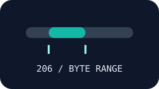

<div align="center">


[](LICENSE)
[](https://github.com/CyberLoop-dev/http-range-lab)
[](https://github.com/CyberLoop-dev/http-range-lab/stargazers)
[](https://github.com/CyberLoop-dev/http-range-lab/commits/main)

</div>

## 🧭 Overview
An interactive simulator for HTTP byte-range requests. Explore how a resource size and a `Range` header produce full responses, partial responses, or unsatisfiable-range errors.

## ✨ Features
- 📦 Supports closed, open-ended, and suffix byte ranges.
- 📏 Shows status code, selected byte interval, and `Content-Range`.
- 🧪 Covers boundary and unsatisfiable cases with automated tests.
- 📴 Simulates protocol behavior locally; it does not make network requests.

## 🖥️ Demo
No hosted demo is published. Run the local simulator.

## 🚀 Quick Start
```bash
npm start
```
Open http://127.0.0.1:4173. Run tests with `npm test`.

## 🧰 Tech Stack
Node.js built-in HTTP server, browser JavaScript, HTML, and CSS. No third-party dependencies.

## 🗂️ Folder Structure
```text
http-range-lab/
├── public/       # UI and range parser
├── tests/        # Node test runner
├── assets/       # Original SVG mark
├── .github/      # CI workflow
├── server.js
└── package.json
```

## 🛣️ Roadmap
- [x] Closed, open-ended, and suffix range simulation.
- [x] 206 and 416 response modeling.
- [ ] Add multipart/byteranges visualization.

## 🤝 Contributing
Contributions are welcome. Add protocol examples and tests for each new range behavior.

## 📄 License
MIT — see [LICENSE](LICENSE).

<div align="center">

</div>
